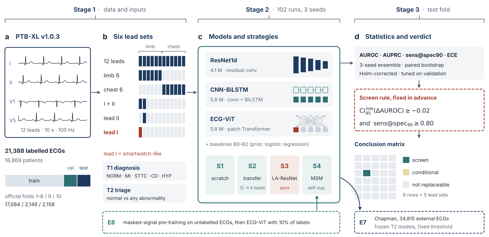
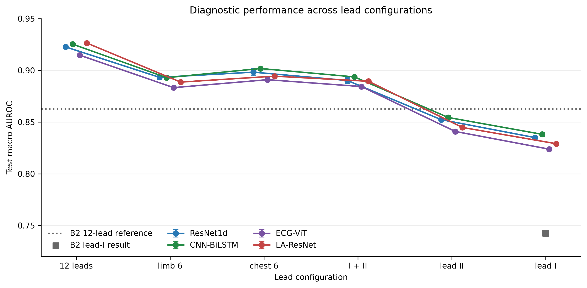
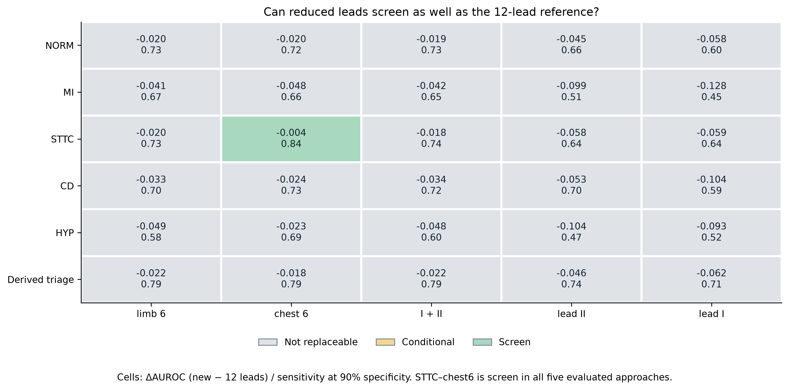
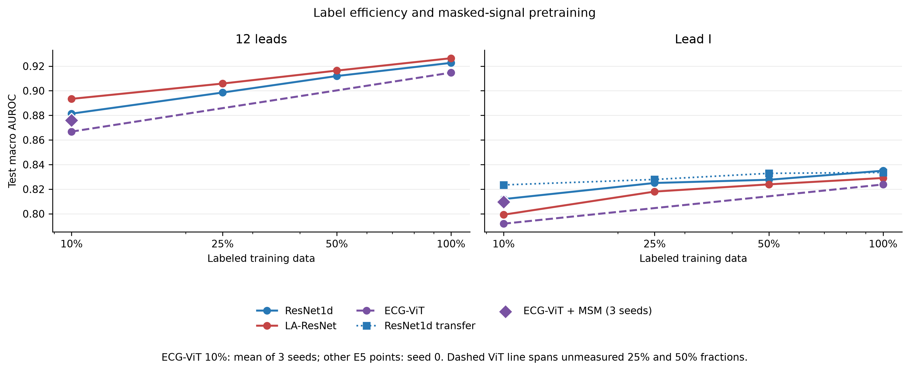
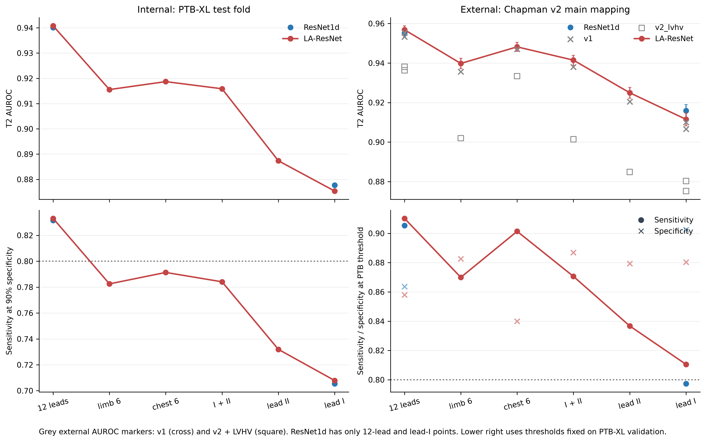

# Twelve to One

**Lead-robust deep learning for multi-label ECG diagnosis and wearable triage on PTB-XL**


A hospital ECG has twelve leads; a smartwatch records one (lead I). This project measures, **diagnosis by diagnosis**, how much of a deep model's ability survives the step from twelve leads to one, and decides with a rule fixed *before* seeing any result whether a reduced lead set can replace the 12-lead ECG for screening.

> **Answer in one line.** Of 30 diagnosis × reduced-lead combinations, **29 cannot replace twelve leads**. Only ST/T change with the six chest leads passes. A single lead can support normal-versus-abnormal triage, but not these five diagnoses.

Course project for *BS6204 Deep Learning for Biomedical Science*, Nanyang Technological University (October 2026). All models, the training loop and the statistics were written from scratch in PyTorch.

---

## Contents

- [Study design](#study-design)
- [Key results](#key-results)
- [Methods at a glance](#methods-at-a-glance)
- [Repository layout](#repository-layout)
- [Reproducing the results](#reproducing-the-results)
- [Report, slides and documents](#report-slides-and-documents)
- [Limitations](#limitations)
- [Data sources and citation](#data-sources-and-citation)

---

## Study design



| | |
|---|---|
| **Data** | PTB-XL v1.0.3, 21,388 ten-second 12-lead ECGs at 100 Hz; official patient-level folds 1–8 / 9 / 10 (17,084 / 2,146 / 2,158) |
| **Tasks** | **T1** five diagnostic superclasses, multi-label (NORM, MI, STTC, CD, HYP) · **T2** triage, normal vs any abnormality |
| **Inputs** | six lead sets: `12lead` · `limb6` · `chest6` · `2lead` (I+II) · `leadII` · `leadI` (smartwatch-like) |
| **Models** | ResNet1d (4.07 M) · CNN-BiLSTM (0.79 M) · ECG-ViT with hand-written attention (0.82 M) |
| **Strategies** | S1 scratch · S2 transfer from 12 leads · **S3 LA-ResNet** (ours: one model for every lead set) · S4 masked-signal self-supervision |
| **Baselines** | B0 prior · B1 logistic regression on raw signal · B2 logistic regression on 22 shift-invariant features per lead |
| **External** | Chapman-Shaoxing/Ningbo, 34,815 ECGs from two Chinese hospitals, frozen models |

**The screen rule (pre-specified).** A reduced lead set may replace 12 leads for a diagnosis only if
1. the paired-bootstrap 95% CI lower bound of ΔAUROC (reduced − 12-lead) is ≥ −0.02, **and**
2. sensitivity at 90% specificity is ≥ 0.80.

One condition met = *conditional*; none = *not replaceable*. Margins of 0.01 and 0.03 were run as sensitivity analyses.

---

## Key results

### RQ1 — architectures on 12 leads

| Model | Macro AUROC (3 seeds) | AUPRC | Sens @ spec 90 | ECE | Seed-ensemble AUROC [95% CI] |
|---|---|---|---|---|---|
| B0 prior | 0.500 | 0.259 | 0.000 | — | — |
| B1 raw-signal LR | 0.512 | 0.287 | 0.142 | 0.111 | — |
| B2 feature LR | 0.863 | 0.701 | 0.627 | 0.028 | — |
| ResNet1d | 0.9227 ± 0.0015 | 0.816 | 0.777 | 0.033 | 0.9298 [0.923, 0.937] |
| CNN-BiLSTM | **0.9253 ± 0.0013** | 0.817 | 0.773 | 0.039 | 0.9292 [0.923, 0.936] |
| ECG-ViT | 0.9147 ± 0.0009 | 0.795 | 0.752 | 0.043 | 0.9221 [0.915, 0.930] |

All three deep models fall inside the published PTB-XL benchmark range (0.921–0.930). ResNet1d and CNN-BiLSTM are statistically tied (Δ +0.0005, 95% CI −0.0020 to +0.0031, Holm p = 1.0).

### RQ2 — how much survives lead reduction



Twelve leads → lead I costs **0.090 AUROC** (ResNet1d ensemble, 95% CI 0.081–0.100). Six or two leads cost 0.02–0.03; the big step is to a single lead.



- **29 / 30 cells not replaceable.** Only **STTC with chest leads** is *screen* (Δ −0.004 [−0.010, +0.001], sensitivity 0.84), and it passes in all five evaluated approaches.
- **Nothing passes with lead I.** Myocardial infarction is worst: AUROC 0.924 → 0.796 (Δ −0.128 [−0.147, −0.107]), sensitivity 0.45.

### Can training, data or self-supervision rescue it?

| Question | Finding |
|---|---|
| Transfer from 12 leads (S2) | Δ −0.0023 to +0.0022 vs scratch; nothing significant after Holm correction |
| One lead-agnostic model (S3 LA-ResNet) | 0.003–0.010 lower than five dedicated models, but **one checkpoint serves all six lead sets**; 12-lead 0.9264 ± 0.0004 |
| 10× more labels on lead I | 0.812 → 0.835 only; 12 leads with 10% of labels (0.881) still beat lead I with all labels |
| Masked-signal pre-training (ECG-ViT, 10% labels) | +0.0065 [+0.0020, +0.0112] on 12 leads, +0.0149 [+0.0091, +0.0210] on lead I |
| Noise at 0 dB, lead I | ResNet1d 0.759 vs CNN-BiLSTM 0.686 — the clean-data ranking flips |



### RQ3 — triage and an external hospital



- Lead-I triage reaches AUROC **0.878**, but sensitivity at 90% specificity is **0.71**, short of the 0.80 screen threshold.
- Frozen models on 34,815 Chapman ECGs: **0.955** (12 leads) and **0.916** (lead I). The external label set is stricter; counting left-ventricular high voltage as abnormal brings the values back to 0.936 / 0.880. PTB-XL thresholds gave 86–90% external specificity, so deployment would need local recalibration.

More findings (F1–F12, each with its source file) are in [`docs/key_findings.md`](docs/key_findings.md).

---

## Methods at a glance

- **ResNet1d** — stride-2 stem (kernel 15), eight residual blocks (kernel 7, 64→256 channels), average + max pooling. Bias: local waveform morphology.
- **CNN-BiLSTM** — convolutional front end (÷4), two-layer bidirectional LSTM (hidden 128), additive attention pooling. Bias: beat-to-beat sequence.
- **ECG-ViT** — 50 patches of 200 ms, D = 128, CLS token, sinusoidal positions, four pre-LayerNorm blocks with hand-written multi-head self-attention. Bias: global interactions.
- **LA-ResNet (ours)** — ResNet1d with 24 input channels: 12 leads (missing ones zeroed) + 12 binary lead-mask channels. Trained with all leads (p = 0.5), a reduced set (0.3) or a random subset (0.2).
- **Shared recipe** — BCE with logits, AdamW (lr 1e-3, wd 1e-2), one-cycle schedule, batch 128, ≤ 50 epochs, early stopping on validation macro AUROC (patience 10), gradient clipping, mixed precision, light augmentation. No per-model tuning.
- **Statistics** — 3 seeds, seed ensembles, 1,000 paired bootstrap resamples, Holm correction over 29 comparisons; temperature scaling for calibration.
- **Leakage control** — official patient-level folds; scaler, thresholds, temperature and the primary approach use train/validation folds only. Nothing was tuned on the test fold or the external cohort.

---

## Repository layout

```
twelve-to-one-ecg/
├── src/                       core library
│   ├── data.py                PTB-XL loading, superclass labels, folds, lead selection, masks, augmentation, noise
│   ├── models.py              ResNet1d, CNN-BiLSTM, ECG-ViT, LA-ResNet, masked-signal model
│   ├── train.py               shared training loop, transfer learning, evaluation, noise robustness
│   ├── metrics.py             AUROC/AUPRC, sens@spec90, calibration, bootstrap, paired tests, screen rule
│   ├── gradcam.py             1-D Grad-CAM for CNNs and Transformers
│   └── inference.py           reload any finished run
├── scripts/                   experiments and analysis
│   ├── prepare_data.py        WFDB → cached NumPy arrays
│   ├── baselines.py           B0, B1, B2
│   ├── run_experiments.py     E1–E5 grid (resumable)
│   ├── pretrain_msm.py / e8_self_supervised.py      E8 self-supervised pre-training
│   ├── download_chapman.py / external_validation.py E7 external validation
│   ├── summarize.py / conclusion_table.py / ensemble_subgroup.py / explain.py
│   └── make_paper_figures.py / make_figA_study_design.py
├── launchers/                 Windows one-click .bat files for the same pipeline
├── results/
│   ├── summary/               all tables and figures (all_runs.csv, paired tests, conclusion table, fig1–fig11)
│   │   ├── paper_figs/        publication figures A–H (PDF + PNG) and tables 1–5
│   │   └── external_chapman*/ E7 results for the three label mappings
│   ├── eda/                   dataset description
│   └── <run>/                 per-run config.json, history.csv, metrics.json (weights not included)
├── docs/
│   ├── report/                final report (PDF) and LaTeX source
│   ├── slides/                presentation (.pptx, with speaker notes)
│   ├── key_findings.md        12 key findings with numbers and source files
│   └── project_overview_zh.pdf  detailed project overview in Chinese
└── requirements.txt
```

Run folders are named `<model>[-variant]_<leads>[_t2]_frac<fraction>_seed<seed>`, e.g. `resnet1d-tfft_leadI_frac1_seed0` is ResNet1d transferred and fine-tuned on lead I.

---

## Reproducing the results

Requirements: Python 3.11, an NVIDIA GPU (the full grid takes many GPU hours), and PyTorch installed for your CUDA version from [pytorch.org](https://pytorch.org/get-started/locally/).

```bash
pip install -r requirements.txt
python scripts/check_env.py
```

1. **Data.** Download [PTB-XL v1.0.3](https://physionet.org/content/ptb-xl/1.0.3/) and unpack it so that `data/ptb-xl/ptbxl_database.csv` exists.
2. **Cache and description.**
   ```bash
   python scripts/prepare_data.py            # data/ptb-xl -> data/cache (100 Hz)
   python scripts/eda.py --cache data/cache --out results/eda
   ```
3. **Baselines and the main grid (E0–E5).**
   ```bash
   python scripts/baselines.py --models b0 b1 b2
   python scripts/run_experiments.py --exp all        # 102 runs, finished runs are skipped
   python scripts/run_experiments.py --exp all --list # progress
   ```
   A single configuration: `python -m src.train --model vit --leads leadI --seed 0`.
4. **Self-supervised pre-training (E8).**
   ```bash
   python scripts/e8_self_supervised.py --cache data/cache --out results --reference_results results --device cuda
   ```
5. **External validation (E7).** Download the [Chapman-Shaoxing/Ningbo database](https://physionet.org/content/ecg-arrhythmia/1.0.0/), then
   ```bash
   python scripts/download_chapman.py --dest <dir> --stage all --mapping v2_lvhv
   python scripts/external_validation.py --data_dir <dir>/WFDBRecords --name chapman --mapping v2 --ptb_cache data/cache --results results --out results/summary --device cuda
   ```
   Repeat with `--mapping v2_lvhv` and `--mapping v1` for the sensitivity analyses.
6. **Tables and figures.**
   ```bash
   python scripts/summarize.py --results results --out results/summary
   python scripts/conclusion_table.py --results results --out results/summary
   python scripts/ensemble_subgroup.py --results results --out results/summary
   python scripts/make_paper_figures.py
   python scripts/make_figA_study_design.py
   ```

To check that the code runs end to end without the real data, `launchers/1_smoke_test_mock.bat` builds a small synthetic dataset and runs every stage on it in 10–20 minutes; its outputs (`results_mock/`) are meaningless by design.

Model weights and per-record predictions are not in the repository (over 1 GB); they are regenerated by the training scripts.

---

## Report, slides and documents

| File | What it is |
|---|---|
| [`docs/report/Twelve_to_One_report.pdf`](docs/report/Twelve_to_One_report.pdf) | Full report: introduction, related work, data, methods, evaluation protocol, results, discussion, appendix |
| [`docs/report/latex/`](docs/report/latex) | LaTeX source of the report (`latexmk -pdf main.tex`) |
| [`docs/slides/Twelve_to_One_slides.pptx`](docs/slides/Twelve_to_One_slides.pptx) | 12 main + 2 backup slides with English speaker notes |
| [`docs/key_findings.md`](docs/key_findings.md) | Findings F1–F12 with exact numbers and the files they come from |
| [`docs/project_overview_zh.pdf`](docs/project_overview_zh.pdf) | 18-page overview of the whole project in Chinese |

---

## Limitations

- Lead I here is extracted from clinical 12-lead recordings, not recorded by a watch (no motion artefacts or poor electrode contact).
- One training dataset at 100 Hz; noise robustness uses synthetic white noise.
- Ablations and label-efficiency runs use a single seed.
- Subgroup results (sex, age) are descriptive, without confidence intervals.
- Grad-CAM and attention maps are illustrations, not causal explanations.

These are research results, not a validated clinical screening system.

---

## Data sources and citation

- Wagner P. *et al.* PTB-XL, a large publicly available electrocardiography dataset. *Scientific Data* 7, 154 (2020). [PhysioNet](https://physionet.org/content/ptb-xl/1.0.3/), CC BY 4.0.
- Strodthoff N. *et al.* Deep learning for ECG analysis: benchmarks and insights from PTB-XL. *IEEE JBHI* 25(5), 1519–1528 (2021).
- Zheng J., Guo H., Chu H. A large scale 12-lead electrocardiogram database for arrhythmia study (v1.0.0). PhysioNet (2022). doi:10.13026/wgex-er52.
- Reyna M. A. *et al.* Will two do? Varying dimensions in electrocardiography: the PhysioNet/Computing in Cardiology Challenge 2021. *Computing in Cardiology* 48 (2021).
- Goldberger A. *et al.* PhysioBank, PhysioToolkit, and PhysioNet. *Circulation* 101(23), e215–e220 (2000).

The full reference list is in the report.
